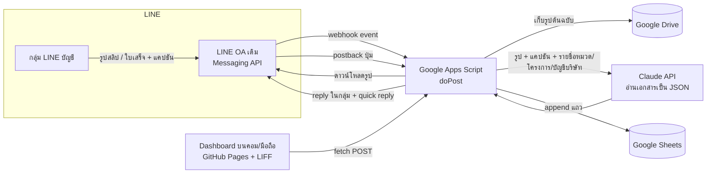

# SGQ บันทึกค่าใช้จ่าย — คอนเซ็ปต์ระบบ (ฉบับร่าง 2)

> สถานะ: **ปรับตามคำตอบเจ้าของระบบแล้ว** · 27 ต.ค. 2569 (ฉบับร่าง 1: 26 ต.ค.)
> แบ่งงาน: Fable วางคอนเซ็ปต์ + ตรวจความถูกต้อง · Opus 5.5 เขียนโค้ด
> ตัวอย่างหน้าเว็บ (ข้อมูลสมมติ): `expense/index.html` — เลือกใช้แนวทาง v2 (ฟอนต์ Prompt + IBM Plex Sans Thai, UI แบบ ledger)

## 0. สิ่งที่ตัดสินใจแล้ว (จากคำตอบ 8 ข้อ)

| เรื่อง | ตัดสินใจ | ผลต่อระบบ |
|---|---|---|
| บอทและกลุ่ม | ใช้ LINE OA ตัวเดิมของตารางงาน · ประมาณ **200 สลิป/เดือน** | เชิญ OA เข้ากลุ่มบัญชี ตั้ง webhook เพิ่ม ไม่ต้องสร้าง OA ใหม่ |
| รายรับ | มีสลิปลูกค้าโอนเข้า → **บันทึกรายรับด้วย** | ทุกรายการมีทิศทาง เงินออก/เงินเข้า · dashboard แสดงรายจ่าย รายรับ คงเหลือ และกำไรขั้นต้นต่อโครงการ |
| เอกสาร | เก็บทุกประเภท: สลิปโอน ใบเสร็จ ใบกำกับภาษี บิลเงินสด · **หัก ณ ที่จ่าย 3%** | เพิ่มฟิลด์ประเภทเอกสาร, VAT 7%, หัก ณ ที่จ่าย (อัตรา/ยอดก่อนหัก/ยอดโอนจริง) · รายงาน ภ.ง.ด.3/53 และภาษีซื้อ |
| โครงการ | **ผูกทุกรายการกับโครงการ** | ชีต `Projects` ดึงรายชื่องานจากตารางงานเดิม · ตารางรายรับ−รายจ่ายต่อโครงการ |
| การจัดหมวด | **บอทตอบในกลุ่ม** พร้อมปุ่มเลือก | ตอบด้วย reply token (ฟรี) + quick reply: เปลี่ยนหมวด / เปลี่ยนโครงการ / หัก ณ ที่จ่าย? |
| การตรวจ | **บันทึกอัตโนมัติ** ตรวจเฉพาะ ซ้ำ / AI ไม่มั่นใจ / ไม่ระบุโครงการ / หัก ณ ที่จ่ายไม่ชัด · ผู้ตรวจ = **แอดมินและผู้ได้รับมอบอำนาจ** | สถานะ `auto` เป็นค่าปกติ คิว "รอตรวจ" เหลือเฉพาะที่ติดธง · สิทธิ์ 4 ระดับ |
| อุปกรณ์ | **ใช้คอมเป็นหลัก** มือถือรองรับ | dashboard ออกแบบจอกว้างก่อน (sidebar, ตารางจริง, แผงรายละเอียดด้านขวา) |
| ตรวจสลิปจริง | **อ่านข้อมูลอย่างเดียว** (ราคายืนยันกับธนาคารอยู่ข้อ 4.2 เผื่อเปิดภายหลัง) | ใช้ AI อ่านอย่างเดียว · เปิด API ตรวจสลิปเฉพาะรายรับได้ภายหลังถ้าต้องการกันสลิปปลอม |

## 1. เป้าหมาย

บันทึกรายจ่ายและรายรับของบริษัทให้ครบ ถูกต้อง และเร็ว โดยไม่เพิ่มงานให้คนหน้างาน:
พนักงานโพสต์สลิป/ใบเสร็จในกลุ่ม LINE "บัญชี" เหมือนเดิม → ระบบอ่านและบันทึกให้ทันที → บอทตอบยืนยันในกลุ่ม →
ฝ่ายบัญชีเปิดหน้าเว็บบนคอมเพื่อตรวจรายการที่ติดธง ดูสรุปต่อโครงการ และส่งออกรายงานภาษี

## 2. สถาปัตยกรรม — ต่อยอดจากของเดิม

ใช้ stack เดียวกับแอปตารางงานทีมช่าง (GitHub Pages + LIFF + Google Apps Script + Google Sheets) ไม่มีเซิร์ฟเวอร์ให้เช่า

| ส่วน | เทคโนโลยี | หมายเหตุ |
|---|---|---|
| รับเอกสารจากกลุ่ม | LINE Messaging API (webhook, reply, postback) | OA เดิม · reply ฟรีไม่กินโควตา |
| ประมวลผล | Google Apps Script (Web App) | โค้ดอยู่ในโปรเจกต์ GAS เดิม (repo `SGQ-Fab`) |
| อ่านเอกสาร | Claude API (vision + structured output) | `claude-haiku-5-5` เป็นหลัก · ส่งต่อ `claude-sonnet-5-5` เมื่อเอกสารซับซ้อน (ใบกำกับภาษีหลายรายการ) |
| เก็บรูป | Google Drive | โฟลเดอร์ต่อเดือน · ~200 รูป ≈ 60 MB/เดือน |
| เก็บข้อมูล | Google Sheets | `Transactions`, `Categories`, `Projects`, `Accounts`, `Users`, `Log` |
| หน้าเว็บ | HTML หน้าเดียวบน GitHub Pages (`/expense/`) | ล็อกอิน LINE (LIFF) · ออกแบบจอคอมก่อน |

## 3. ขั้นตอนบันทึกอัตโนมัติ

1. สมาชิกโพสต์รูปในกลุ่ม (แคปชันช่วยได้ เช่น `ค่าแรง บ้านคุณวิทยา หัก3` หรือ `รับเงินงวด 2 โรงงาน ABC`)
2. LINE → webhook → GAS ตรวจว่า event มาจากกลุ่มบัญชีและเป็นรูป → ดาวน์โหลดทันที → เก็บ Drive
3. ส่งรูป + แคปชัน + รายชื่อหมวด/โครงการ/บัญชีบริษัท ให้ Claude อ่าน ขอ JSON:
   `{ doc_type, direction, amount, fee, date, time, bank_from, bank_to, payer_name, payee_name, account_to_masked, ref,
      vat: {subtotal, amount, tax_id, invoice_no} | null, wht: {rate, amount, gross} | null,
      suggested_category, suggested_project, confidence, notes }`
   - `direction` ตัดสินจากเลขบัญชีผู้รับ: ตรงกับบัญชีบริษัท → **รายรับ** · ไม่ตรง → **รายจ่าย**
   - `doc_type`: สลิปโอน / ใบเสร็จ / ใบกำกับภาษี / บิลเงินสด (รูปที่ไม่ใช่เอกสารการเงิน → ไม่บันทึก ไม่ตอบ)
4. ตรรกะหลังอ่าน → **บันทึกทันที** สถานะ `auto` ยกเว้นติดธงต่อไปนี้จึงเป็น `pending` (รอตรวจ)
   - เลขอ้างอิงซ้ำกับแถวเดิม → ธง "ซ้ำ"
   - `confidence < 0.8` → ธง "AI ไม่มั่นใจ"
   - ไม่ทราบโครงการ (แคปชันไม่บอก, AI เดาไม่ได้) → ธง "ไม่ระบุโครงการ" และบอทถามในกลุ่ม
   - รายจ่ายหมวดบริการ (ค่าแรง ค่าจ้างทำของ ค่าขนส่ง) ที่ไม่รู้ว่าหัก ณ ที่จ่ายหรือไม่ → ธง "หัก ณ ที่จ่ายไม่ชัด" และบอทถาม
5. append แถวลง `Transactions` พร้อมลิงก์รูป ผู้โพสต์ `messageId`
6. ตอบในกลุ่มด้วย reply token (ภายใน ~1 นาที) เช่น
   - รายจ่าย: `✅ บันทึกแล้ว ฿12,450.00 → หจก. สยามกระจกนิรภัย · 26 ต.ค. 14:32 · กระจก · บ้านคุณวิทยา` ปุ่ม: เปลี่ยนหมวด / เปลี่ยนโครงการ / ไม่ใช่ค่าใช้จ่าย
   - ค่าแรง: `✅ บันทึกแล้ว ฿4,500.00 → นายสมศักดิ์ · ค่าแรงช่าง · หัก ณ ที่จ่าย 3% หรือไม่?` ปุ่ม: หัก 3% (ยอดก่อนหัก ฿4,639.18) / ไม่หัก
   - รายรับ: `💰 รับเงิน ฿150,000.00 จาก คุณวิทยา → KBank xxx-452-1 · บ้านคุณวิทยา · บันทึกเป็นรายรับแล้ว` ปุ่ม: เปลี่ยนโครงการ / ลูกค้าหัก 3%
7. กดปุ่ม → postback → GAS อัปเดตแถว (บันทึกชื่อคนกดและเวลาใน `Log`)

ข้อควรรู้ทางเทคนิค (คงเดิมจากร่าง 1)
- GAS อ่าน header ไม่ได้ จึงตรวจลายเซ็น `X-Line-Signature` ไม่ได้ → ใช้ URL ลับ + ตรวจ `destination`/`groupId` · ถ้าต้องการแน่นหนากว่านี้ใส่ Cloudflare Worker (ฟรี) หน้า GAS
- GAS ตอบ POST เป็น 302 → ปุ่ม Verify ใน LINE Developers ฟ้อง error แต่ event จริงทำงานปกติ
- เวลาต่อรายการ ~5–10 วินาที อยู่ในกรอบ reply token · สลิปเก่าก่อนติดตั้งดึงย้อนหลังไม่ได้ ต้องส่งใหม่หรืออัปโหลดในเว็บ

## 4. การอ่านเอกสารและทางเลือกตรวจสลิปจริง

### 4.1 อ่านด้วย AI (ใช้)
- `claude-haiku-5-5`: รูปสลิป ~1,500 โทเคน + คำสั่ง ~800 + ผล ~200 ≈ **0.01 บาท/รายการ** → 200 รายการ ≈ 2–3 บาท/เดือน
- ใบกำกับภาษีหลายรายการ ส่งต่อ `claude-sonnet-5-5` (≈ 0.2 บาท/รายการ) เฉพาะเมื่อ Haiku ไม่มั่นใจ → รวมทั้งเดือนไม่เกิน 20 บาท
- บังคับสคีมา JSON ด้วย structured output · ส่งรายชื่อหมวด/โครงการ/บัญชีบริษัทไปให้เลือก ลดการเดา

### 4.2 ยืนยันสลิปจริงกับธนาคาร (ยังไม่ใช้ — ราคาตามที่ถาม)
ผู้ให้บริการไทยอ่าน QR บนสลิปแล้วถามธนาคารว่าโอนจริง ได้ยอด/วันเวลา/ผู้โอน/ผู้รับที่ยืนยันแล้ว ใช้ได้เฉพาะ **สลิปโอนที่มี QR** (ใบเสร็จ/บิลเงินสดใช้ไม่ได้) ราคาที่พบ (ต.ค. 2569 ควรยืนยันหน้าเว็บผู้ให้บริการก่อนสมัคร):

| ผู้ให้บริการ | แพ็กเกจเริ่มต้น | ≈ บาท/สลิป | สำหรับ 200 สลิป/เดือน |
|---|---|---|---|
| Slip2Go | 88 บาท / 352 สลิป · 188 บาท / 854 สลิป | 0.22–0.25 | ≈ 50 บาท/เดือน |
| Thunder | 99–159 บาท / 400 สลิป (ทดลองฟรี 100 สลิป) | 0.25–0.40 | ≈ 100–160 บาท/เดือน |
| SlipOK | ฟรี 100 สลิป/เดือน · 210–360 บาท / 500–1,000 สลิป | 0.36–0.42 | ≈ 210 บาท/เดือน (หรือฟรีถ้าตรวจเฉพาะรายรับ ≤ 100) |
| EasySlip | ~350 บาท / 1,000 สลิป | ~0.35 | ≈ 350 บาท/เดือน |

ข้อเสนอ: เริ่มด้วยอ่านอย่างเดียว · ถ้าภายหลังกังวลสลิปปลอม เปิดยืนยันเฉพาะ **รายรับ** (ลูกค้าโอนเข้า ~10–20 สลิป/เดือน) ซึ่งอยู่ในโควตาฟรีของ SlipOK หรือราว 5 บาท/เดือนกับ Slip2Go

## 5. โครงสร้างข้อมูล (ชีต `Transactions`)

| กลุ่ม | คอลัมน์ | หมายเหตุ |
|---|---|---|
| ระบบ | id, created_at, source (line/manual), line_message_id, line_user_id, poster_name, image_url | |
| เอกสาร | doc_type (slip/receipt/tax_invoice/cash_bill), doc_date, doc_time, ref, invoice_no | ref ใช้กันซ้ำ |
| เงิน | direction (out/in), amount (ยอดโอนจริง), fee, payment_method (transfer/cash/card) | |
| คู่ค้า | payer_name, payee_name, bank_from, bank_to, account_to_masked, counterparty_tax_id | เลขบัญชีเก็บแบบปิดบางส่วน |
| ภาษี | vat_subtotal, vat_amount (7%), wht_rate (0/1/2/3/5), wht_amount, wht_gross (ยอดก่อนหัก), wht_by_customer_amount | รายจ่าย: บริษัทหัก → ออก 50 ทวิ ยื่น ภ.ง.ด.3/53 · รายรับ: ลูกค้าหัก → รอรับ 50 ทวิ |
| จัดหมวด | category, project, vendor, note | AI เสนอ → ปุ่มในกลุ่ม/เว็บยืนยัน |
| สถานะ | status (auto/pending/approved/rejected), flags (dup/low_conf/no_project/wht_unknown), confidence, duplicate_of, reviewed_by, reviewed_at | `auto` และ `approved` นับยอด |

ชีตประกอบ: `Categories` · `Projects` (ซิงก์จากตารางงานเดิม + สถานะเปิด/ปิดงาน) · `Accounts` (บัญชีบริษัทแบบปิดบางส่วน ใช้แยกเงินเข้า/ออก) · `Users` (LINE userId, ชื่อ, สิทธิ์) · `Log` (ทุกการแก้/อนุมัติ)

สิทธิ์ 4 ระดับ: **แอดมิน** ตั้งค่าทุกอย่าง · **ผู้ได้รับมอบอำนาจ** ตรวจ/แก้/อนุมัติ/ส่งออก · **พนักงาน** ส่งสลิปในกลุ่ม เห็นเฉพาะที่ตนเองส่ง · **ดูอย่างเดียว** ดูสรุป

## 6. หน้าเว็บ (ออกแบบจอคอมก่อน)

| หน้า | มีอะไร |
|---|---|
| ภาพรวม | เลือกเดือน · รายจ่าย / รายรับ / คงเหลือ / รอตรวจ / เทียบเดือนก่อน · กราฟรายวัน (สลับ รายจ่าย-รายรับ) · ตามหมวด · **ตามโครงการ (รายรับ−รายจ่าย)** · สรุปภาษีเดือนนี้ (หัก ณ ที่จ่าย, ภาษีซื้อ) · รายการล่าสุด · สถานะบอท |
| รายการ | จอคอมเป็นตารางจริง เรียงตามวันที่/ยอดได้ · ตัวกรอง ประเภท/เอกสาร/หมวด/โครงการ/สถานะ/ผู้ส่ง · คลิกเปิดแผงรายละเอียดด้านขวา แก้หมวด โครงการ หัก ณ ที่จ่าย VAT · มือถือเป็นแถวการ์ด |
| ตรวจสอบ | เฉพาะรายการติดธง บอกเหตุผลทุกใบ · ปุ่มตัดสินในที่เดียว |
| เพิ่มรายการ | เงินสด/รายรับที่ไม่มีสลิป · เลือกเอกสาร หัก ณ ที่จ่าย VAT แนบรูป |
| เมนู | วิธีทำงานของบอท · ส่งออก Excel/PDF รายเดือน, **รายงานหัก ณ ที่จ่าย (ภ.ง.ด.3/53)**, **รายงานภาษีซื้อ** · ตั้งค่าหมวด โครงการ บัญชีบริษัท ผู้ใช้/สิทธิ์ นโยบายการตรวจ |

## 7. ความปลอดภัย (คงเดิม)

ล็อกอิน LINE + userId ต้องอยู่ใน `Users` · ชีต/Drive ไม่แชร์สาธารณะ รูปเสิร์ฟผ่าน GAS ตามสิทธิ์ · เลขบัญชีเก็บแบบปิดบางส่วน · ทุกการแก้บันทึกใน `Log` · token/API key อยู่ใน Script Properties

## 8. แผนการทำงาน (ปรับ)

| ระยะ | งาน | ผลลัพธ์ |
|---|---|---|
| 0 ✔ | คอนเซ็ปต์ + หน้าตัวอย่าง v2 → เก็บความเห็น | เสร็จ (PR #1) |
| 0.5 | ปรับหน้าตัวอย่างตามคำตอบ: รายรับ หัก ณ ที่จ่าย VAT โครงการ นโยบายอัตโนมัติ จอคอม | กำลังทำ |
| 1 | เชิญ OA เข้ากลุ่ม · webhook GAS · อ่านเอกสารด้วย AI · เขียนชีต · ตอบในกลุ่มพร้อมปุ่ม | สลิปบันทึกอัตโนมัติ |
| 2 | Dashboard ต่อข้อมูลจริง · ล็อกอิน LIFF · คิวตรวจ/แก้ | ใช้งานจริง |
| 3 | เพิ่มรายการเอง · รายงาน Excel/PDF, ภ.ง.ด.3/53, ภาษีซื้อ · ซิงก์โครงการจากตารางงาน | ครบระบบ |
| 4 (ถ้าต้องการ) | ยืนยันสลิปจริงเฉพาะรายรับ | กันสลิปปลอม |

## 9. คำถามที่เหลือ (ก่อนเริ่มระยะ 1)

1. บริษัทจดทะเบียน VAT หรือไม่? (ถ้าจด จะทำรายงานภาษีซื้อจากใบกำกับภาษีให้ด้วย)
2. บัญชีบริษัทที่ใช้รับ/จ่ายมีกี่บัญชี ธนาคารใดบ้าง? (ขอเฉพาะ 4 หลักท้ายตอนติดตั้ง ใช้แยกเงินเข้า/ออก)
3. ใครเป็นแอดมินและผู้ได้รับมอบอำนาจ (ชื่อใน LINE)? ตั้งค่าได้ตอนติดตั้ง
4. มี Anthropic API key แล้วหรือยัง? (ถ้ายัง สมัครที่ console.anthropic.com ใช้เวลาไม่กี่นาที)
5. โค้ดฝั่ง Apps Script จะใส่ในโปรเจกต์ GAS เดิมของตารางงาน หรือแยกโปรเจกต์ใหม่? (แนะนำแยก เพื่อไม่ให้กระทบแอปตารางงาน)
