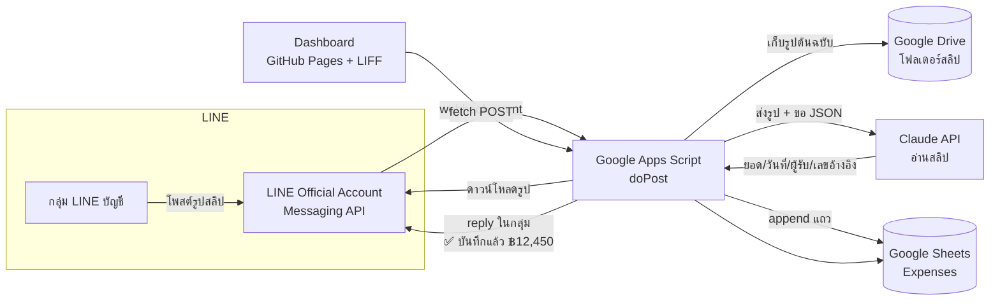

# SGQ บันทึกค่าใช้จ่าย — คอนเซ็ปต์ระบบ (ฉบับร่าง 1)

> สถานะ: **ร่างเพื่อขอความเห็น** · วันที่ 26 ต.ค. 2569
> แบ่งงาน: Fable วางคอนเซ็ปต์ + ตรวจความถูกต้อง · Opus 5.5 เขียนโค้ด
> ตัวอย่างหน้าเว็บ (ข้อมูลสมมติ): `expense/index.html`

## 1. เป้าหมาย

บันทึกค่าใช้จ่ายของบริษัทให้ครบและเร็ว โดย **ไม่เพิ่มงานให้คนหน้างาน**:
พนักงานโพสต์สลิปโอนเงินในกลุ่ม LINE "บัญชี" เหมือนที่ทำอยู่แล้ว → ระบบอ่านสลิปและบันทึกให้เอง →
ฝ่ายบัญชีเปิดหน้าเว็บเพื่อตรวจ จัดหมวด ดูสรุป และส่งออกรายงาน

สิ่งที่ต้องได้
- สลิปทุกใบในกลุ่มถูกบันทึกภายในไม่กี่วินาที พร้อมรูปต้นฉบับ
- ยอดเงิน วันที่ ผู้รับ ธนาคาร เลขอ้างอิง ถูกอ่านอัตโนมัติ (คนตรวจทานเฉพาะที่ไม่ชัวร์)
- Dashboard ดูยอดรายเดือน แยกตามหมวด / โครงการ / ผู้ส่ง และคิวรายการที่รอตรวจ
- เพิ่มรายการที่ไม่มีสลิป (เงินสด) ได้จากหน้าเว็บ
- ข้อมูลอยู่ใน Google Sheets ที่บริษัทเป็นเจ้าของ ส่งออก Excel/PDF ได้

## 2. สถาปัตยกรรม — ต่อยอดจากของเดิม

ใช้ stack เดียวกับแอปตารางงานทีมช่างที่ใช้อยู่ (GitHub Pages + LIFF + Google Apps Script + Google Sheets)
เพื่อให้ดูแลง่าย ไม่มีเซิร์ฟเวอร์ให้เช่า และคนในทีมคุ้นเคยอยู่แล้ว

องค์ประกอบ
| ส่วน | เทคโนโลยี | หมายเหตุ |
|---|---|---|
| รับสลิปจากกลุ่ม | LINE Messaging API (webhook) | เชิญ OA เข้ากลุ่มบัญชี ใช้ OA เดิมของตารางงานได้ |
| ประมวลผล | Google Apps Script (Web App) | โค้ดอยู่ในโปรเจกต์ GAS เดิม (repo `SGQ-Fab`) |
| อ่านสลิป | Claude API (vision) | แนะนำ `claude-haiku-5-5` ต้นทุนราว 0.01 บาท/สลิป ดูข้อ 4 |
| เก็บรูป | Google Drive | โฟลเดอร์ส่วนตัว แยกโฟลเดอร์ต่อเดือน |
| เก็บข้อมูล | Google Sheets | ชีต `Expenses`, `Categories`, `Projects`, `Accounts`, `Users` |
| หน้าเว็บ | HTML หน้าเดียวบน GitHub Pages (`/expense/`) | ล็อกอิน LINE (LIFF) เหมือนแอปตารางงาน |

## 3. ขั้นตอนบันทึกสลิปอัตโนมัติ

1. สมาชิกโพสต์รูปสลิปในกลุ่ม (พิมพ์แคปชันได้ เช่น `กระจก บ้านคุณวิทยา`)
2. LINE ส่ง webhook → GAS ตรวจว่า event มาจากกลุ่มบัญชี (ตรวจ `groupId` และ `destination`) และเป็นรูปภาพ
3. GAS ดาวน์โหลดรูปจาก LINE ทันที (LINE ไม่เก็บไฟล์ให้ดึงย้อนหลังระยะยาว) → บันทึกลง Drive
4. ส่งรูป + แคปชัน + รายชื่อหมวด/โครงการ/บัญชีบริษัท ให้ Claude อ่าน ขอผลเป็น JSON ตามสคีมา:
   `{ is_slip, amount, fee, date, time, bank_from, bank_to, receiver_name, account_to_masked, ref, suggested_category, suggested_project, confidence, notes }`
5. ตรรกะหลังอ่าน
   - `is_slip = false` (รูปทั่วไป มีม สติกเกอร์) → ไม่บันทึก ไม่ตอบ
   - **เลขอ้างอิงซ้ำ** กับแถวเดิม → บันทึกแต่ติดธง "ซ้ำ" และแจ้งในกลุ่ม
   - **บัญชีผู้รับเป็นของบริษัท** → เป็นเงินเข้า ไม่ใช่ค่าใช้จ่าย → ติดธง "รายรับ?" ส่งเข้าคิวตรวจ
   - `confidence < 0.8` → สถานะ "รอตรวจ" และแจ้งให้บัญชีดูยอด
   - ที่เหลือ → บันทึกสถานะตามนโยบายที่เลือก (ดูคำถามข้อ 6)
6. append แถวลงชีต `Expenses` พร้อมลิงก์รูป, ผู้โพสต์ (LINE userId → ชื่อ), `messageId`
7. ตอบกลับในกลุ่มด้วย **reply token** (ฟรี ไม่กินโควตาข้อความ แต่ต้องตอบภายใน ~1 นาที):
   `✅ บันทึกแล้ว ฿12,450.00 → หจก. สยามกระจกนิรภัย · 26 ต.ค. 14:32 · หมวด: กระจก`
   พร้อมปุ่ม quick reply: เปลี่ยนหมวด / เปลี่ยนโครงการ / ไม่ใช่ค่าใช้จ่าย
8. ถ้ากดปุ่มในกลุ่ม → postback event → GAS อัปเดตแถวนั้น

ข้อควรรู้ทางเทคนิค
- GAS อ่าน header ของ request ไม่ได้ จึง **ตรวจลายเซ็น LINE (`X-Line-Signature`) ไม่ได้** → ป้องกันด้วย URL ลับ + ตรวจ `destination`/`groupId` + ไม่รับ event จากห้องอื่น
  ถ้าต้องการความแน่นหนากว่านี้ ใส่ Cloudflare Worker (ฟรี) หน้า GAS เพื่อตรวจลายเซ็นและตอบ 200 ให้ LINE ทันที
- GAS ตอบ POST ด้วย 302 redirect → ปุ่ม "Verify" ใน LINE Developers จะฟ้อง error แต่ event จริงส่งถึงและประมวลผลได้ตามปกติ (เป็นพฤติกรรมที่รู้กันของ GAS)
- เวลาประมวลผลต่อสลิป ~5–10 วินาที (ดาวน์โหลด 1 วิ + อ่านสลิป 3–6 วิ + เขียนชีต 1 วิ) อยู่ในกรอบ reply token
- สลิปเก่าในกลุ่มก่อนติดตั้งบอท ดึงย้อนหลังไม่ได้ ต้องส่งใหม่ในกลุ่มหรืออัปโหลดผ่านหน้าเว็บ

## 4. วิธีอ่านสลิป — ทางเลือกและข้อเสนอ

| วิธี | ข้อดี | ข้อเสีย | ต้นทุน |
|---|---|---|---|
| **A. AI vision (Claude)** ← เสนอ | อ่านได้ทุกธนาคาร/ทุก layout, อ่านใบเสร็จ-บิลเงินสดได้ด้วย, เข้าใจแคปชัน, เสนอหมวดให้ | ไม่ได้ยืนยันกับธนาคารว่าสลิปจริง | `claude-haiku-5-5` ≈ 0.01 บาท/สลิป (300 สลิป/เดือน ≈ 3 บาท) |
| B. API ตรวจสลิป (SlipOK, EasySlip ฯลฯ) | ยืนยันกับธนาคารว่าโอนจริง ได้ข้อมูลตรง 100% | อ่านได้เฉพาะสลิปที่มี QR, ใบเสร็จไม่ได้ | ~0.3–1 บาท/สลิป + ค่าแพ็กเกจ |
| C. OCR ทั่วไป (Cloud Vision) + parser | ถูก | ต้องเขียน parser ต่อธนาคาร พังเมื่อธนาคารเปลี่ยน layout | ~0.05 บาท/สลิป |

ข้อเสนอ: เริ่มด้วย **A** (structured output บังคับสคีมา JSON, ส่งรายชื่อหมวด/โครงการไปให้เลือก) และเปิดช่องให้เสริม **B** ภายหลังเฉพาะรายการยอดสูง ถ้าต้องการกันสลิปปลอม

## 5. โครงสร้างข้อมูล (ชีต `Expenses`)

| คอลัมน์ | ตัวอย่าง | ที่มา |
|---|---|---|
| id | EXP-2026-10-0142 | ระบบ |
| created_at | 2026-10-26 14:32:10 | ระบบ |
| source | line / manual | ระบบ |
| line_message_id, line_user_id, poster_name | … | LINE |
| image_url | ลิงก์ Drive | ระบบ |
| slip_date, slip_time | 2026-10-26, 14:31 | AI อ่าน |
| amount, fee | 12450.00, 0 | AI อ่าน |
| bank_from, bank_to | KBANK, SCB | AI อ่าน |
| receiver_name, account_to_masked | หจก. สยามกระจกนิรภัย, xxx-x-xx123-4 | AI อ่าน |
| ref | 015298xxxxx | AI อ่าน (ใช้กันซ้ำ) |
| direction | out / in | ระบบ (เทียบบัญชีบริษัท) |
| category | กระจก | AI เสนอ → คนยืนยัน |
| project | บ้านคุณวิทยา บางนา | แคปชัน/AI เสนอ → คนยืนยัน |
| vendor | หจก. สยามกระจกนิรภัย | ค่าเริ่มต้น = receiver_name |
| payment_method | transfer / cash / card | ระบบ/คนกรอก |
| note | แคปชันจาก LINE | LINE |
| status | pending / approved / rejected | นโยบาย + คนตรวจ |
| confidence | 0.97 | AI |
| duplicate_of | EXP-2026-10-0139 | ระบบ |
| reviewed_by, reviewed_at | คุณแอน, … | หน้าเว็บ |

ชีตประกอบ: `Categories` (ชื่อ, สี, ลำดับ) · `Projects` (ดึงจากตารางงานเดิมได้) · `Accounts` (เลขบัญชีบริษัทแบบปิดบางส่วน ใช้แยกเงินเข้า/ออก) · `Users` (LINE userId, ชื่อ, สิทธิ์: admin / accounting / viewer)

## 6. หน้าเว็บ (Dashboard)

| หน้า | มีอะไร |
|---|---|
| ภาพรวม | เลือกเดือน · ยอดรวม / จำนวนสลิป / รอตรวจ / เทียบเดือนก่อน · กราฟรายวัน · ตามหมวด · ตามโครงการ · สลิปล่าสุด · สถานะบอท |
| รายการ | ค้นหา + ตัวกรอง (หมวด/สถานะ/โครงการ/ผู้ส่ง) · แถวมีรูปย่อ ยอด ผู้รับ ธนาคาร ชิปสถานะ · แตะดูรายละเอียด/แก้ไข/อนุมัติ |
| ตรวจสอบ | คิวรายการรอตรวจ · เลือกหมวด/โครงการแล้วอนุมัติได้ในที่เดียว · เตือนรายการซ้ำ / เงินเข้าบัญชีบริษัท / AI ไม่มั่นใจ |
| เพิ่มรายการ | กรอกค่าใช้จ่ายเงินสด แนบรูปใบเสร็จ |
| เมนู | วิธีการทำงานของบอท · ส่งออก Excel/PDF รายเดือน · ตั้งค่าหมวด โครงการ บัญชีบริษัท ผู้มีสิทธิ์ |

สิทธิ์ (ร่าง): **admin** ตั้งค่าทุกอย่าง · **accounting** ตรวจ/แก้/อนุมัติ/ส่งออก · **viewer** ดูสรุปอย่างเดียว
มือถือใช้ bottom nav เหมือนแอปตารางงาน · จอคอม (≥ 900px) เป็น sidebar + 2 คอลัมน์

## 7. ความปลอดภัยของข้อมูลการเงิน

- หน้าเว็บต้องล็อกอิน LINE และ userId อยู่ในชีต `Users` เท่านั้น (backend ปฏิเสธคนอื่น)
- ชีตและโฟลเดอร์ Drive ไม่แชร์สาธารณะ รูปสลิปเสิร์ฟผ่าน GAS ตามสิทธิ์ (ไม่ใช่ลิงก์ anyone-with-link)
- เลขบัญชีเก็บแบบปิดบางส่วนตามที่ปรากฏบนสลิป ไม่เก็บเลขเต็ม
- ทุกการแก้ไข/อนุมัติบันทึกชื่อและเวลา (audit trail) ในชีต `Log`
- Channel access token / API key อยู่ใน Script Properties ไม่อยู่ในโค้ดหน้าเว็บ

## 8. แผนการทำงาน

| ระยะ | งาน | ผลลัพธ์ |
|---|---|---|
| 0 (ตอนนี้) | คอนเซ็ปต์ + หน้าตัวอย่างข้อมูลสมมติ → เก็บความเห็น | เอกสารนี้ + `expense/index.html` |
| 1 | เชิญ OA เข้ากลุ่ม · webhook GAS · อ่านสลิปด้วย AI · เขียนชีต · ตอบในกลุ่ม | สลิปบันทึกอัตโนมัติ |
| 2 | Dashboard ต่อข้อมูลจริง · ล็อกอิน LIFF · คิวตรวจ/แก้/อนุมัติ | ใช้งานจริงได้ |
| 3 | เพิ่มรายการเงินสด · ส่งออก Excel/PDF · ผูกโครงการจากตารางงาน · (ถ้าต้องการ) รายรับ, ตรวจสลิปกับธนาคาร | ครบระบบ |

## 9. คำถามเพื่อให้ตรงความต้องการ

1. **กลุ่มและบอท** — OA ตัวเดิมของตารางงานอยู่ในกลุ่มบัญชีแล้วหรือยัง ใช้ตัวเดิมได้ไหม? คนโพสต์สลิปมีกี่คน ปริมาณกี่สลิป/เดือน?
2. **ประเภทรายการในกลุ่ม** — มีเฉพาะสลิปโอนจ่าย หรือมีสลิปรับเงินจากลูกค้าด้วย? ต้องบันทึกรายรับไหม?
3. **ใบเสร็จ/บิลเงินสด/ใบกำกับภาษี** — ถ่ายรูปส่งในกลุ่มด้วยไหม? ให้ AI อ่านด้วยหรือเฉพาะสลิปโอน? ต้องเก็บ VAT / เลขผู้เสียภาษีไหม?
4. **หมวดและโครงการ** — หมวดที่ร่างไว้ 9 หมวดตรงไหม? ต้องผูกค่าใช้จ่ายกับ "งาน/โครงการ" เพื่อดูต้นทุนต่องานไหม (ดึงรายชื่องานจากตารางงานเดิมได้)?
5. **การจัดหมวด** — (ก) คนโพสต์พิมพ์แคปชันแล้ว AI จับ (ข) บอทตอบในกลุ่มพร้อมปุ่มเลือก (ค) บอทเงียบ บัญชีจัดในเว็บ — ชอบแบบไหน บอทตอบในกลุ่มจะรบกวนไหม?
6. **การอนุมัติ** — ทุกรายการต้องมีคนอนุมัติ หรือบันทึกอัตโนมัติแล้วตรวจเฉพาะที่ซ้ำ/ไม่มั่นใจ? ใครมีสิทธิ์ดู/แก้บ้าง?
7. **การใช้งานหน้าเว็บ** — ใช้บนมือถือใน LINE เป็นหลัก หรือบัญชีใช้บนคอมด้วย? ล็อกอิน LINE แบบเดิมโอเคไหม?
8. **รายงาน** — ส่งออก Excel/PDF รายเดือนพอไหม หรือต้องส่งให้สำนักงานบัญชีในรูปแบบเฉพาะ?
9. **ตรวจสลิปจริง** — ต้องยืนยันกับธนาคารว่าโอนจริง (API เสียเงิน) หรืออ่านข้อมูลอย่างเดียวพอ?
10. **ข้อมูลย้อนหลัง** — เริ่มบันทึกตั้งแต่เดือนไหน? ต้องนำสลิปเก่าเข้าระบบด้วยไหม?
11. **API key** — มี Anthropic API key อยู่แล้วไหม (ค่าอ่านสลิปราวเดือนละไม่กี่บาท)?
